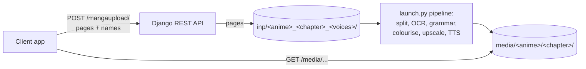

# LiveManga

A manga processing pipeline with a small Django REST API. It takes raw manga pages and produces enhanced, colourised, read-aloud versions; a Flutter client (not in this repository) uploads chapters through the API.

## What it does

- **Panel splitting** of manga pages
- **Text detection and OCR** (YOLOv5-based detection, PaddleOCR)
- **Grammar correction** of recognised text (Gramformer)
- **Text-to-speech** with multiple voices (XTTS)
- **Colourisation** of black-and-white pages
- **Upscaling** (BSRGAN) and denoising
- **REST API** (Django REST Framework) that receives chapter uploads

Translation is not implemented.

## Architecture



The API saves uploads; `launch.py` runs the pipeline separately (the call from the API is commented out in `livemanga/views.py`).

## Tech stack

Python, Django and Django REST Framework, PyTorch (YOLOv5, BSRGAN, colourisation and denoising networks), PaddleOCR, Gramformer, Coqui TTS (XTTS), OpenCV and Pillow.

## Project structure

- `livemanga/`: Django project and API (`views.py`, `serializers.py`, `models.py`)
- `launch.py`: the processing pipeline; `split_manga.py`, `ocr.py`, `colorizator.py`, `inference_text.py`, `inference_color.py` are its steps
- `models/`, `networks/`, `denoising/`: model code and some weights
- `utils/`: image and OCR helpers
- `inp/`, `media/`, `txt/`: sample inputs and outputs
- `html/`, `latex/`: generated Doxygen documentation

## Getting started

The API alone (no GPU needed):

```bash
git clone https://github.com/a-3isa/livemanga
cd livemanga
pip install -r requirements-api.txt
export DJANGO_SECRET_KEY=...           # see .env.example
export DJANGO_DEBUG=1                  # local only: also serves uploaded media
python manage.py migrate
python manage.py createsuperuser       # optional, for /admin
python manage.py runserver
```

| Variable | Required | Purpose |
|---|---|---|
| `DJANGO_SECRET_KEY` | yes | Django's signing key; the server will not start without it |
| `DJANGO_DEBUG` | no | `1` turns on debug mode (development only) |
| `DJANGO_ALLOWED_HOSTS` | no (`localhost,127.0.0.1`) | Comma-separated host names; add `.ngrok.io` when using a tunnel |

The pipeline additionally needs `opencv-python torch torchvision numpy paddleocr TTS gramformer` and pre-trained weights for detection, colourisation, upscaling and TTS in the folders above (not all are included). Put pages in `inp/`, then run `python launch.py`. A CUDA-capable GPU is recommended.

## API

| Route | Purpose |
|---|---|
| `GET /` | Number of uploaded chapters waiting in `inp/` |
| `POST /mangaupload/` (multipart) | `anime_name`, `chapter_name`, `voices_number`, `image` (one or more pages). Names must be plain (no slashes, colons or `..`). Returns the media URL the results will appear under |
| `GET /media/...` | Processed output (served by Django only when `DJANGO_DEBUG=1`) |
| `/admin/` | Django admin |

## Testing

```bash
DJANGO_SECRET_KEY=test python manage.py test livemanga
```

CI runs the system check, a migrations check and these tests on every pull request and on pushes to `main`. The ML pipeline has no automated tests.

## Security notes

- Secrets and debug mode come from the environment; nothing secret is committed, and the database is git-ignored.
- Upload names are validated so files cannot be written outside `inp/` and `media/`.
- The upload endpoint has no authentication: put the API behind your own access control before exposing it.
- See [SECURITY.md](SECURITY.md) to report a vulnerability.

## License and author

[MIT](LICENSE). Built by Ahmed Ibrahim Hussien ([a-3isa](https://github.com/a-3isa)).
